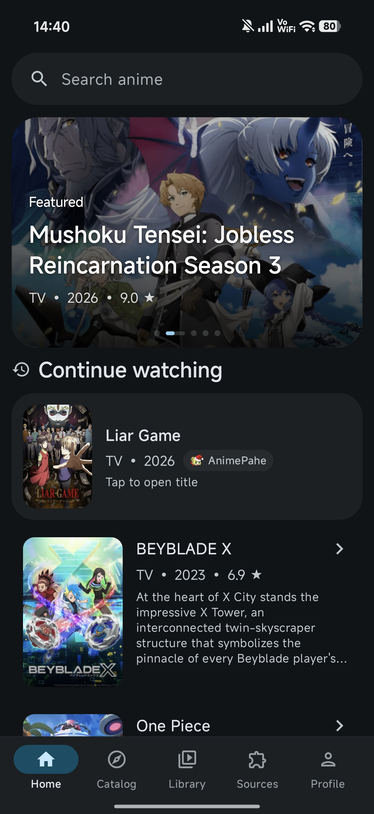
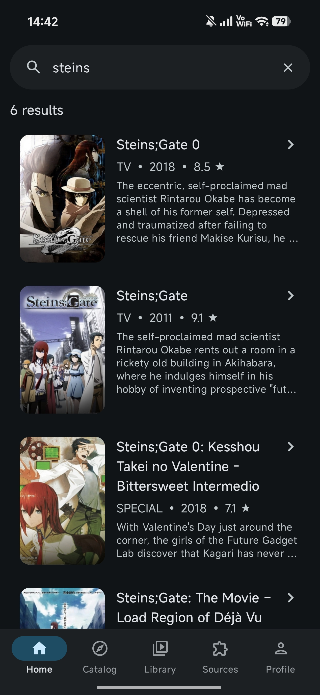
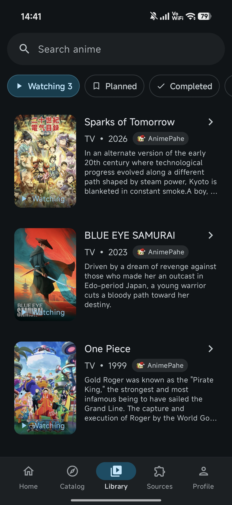
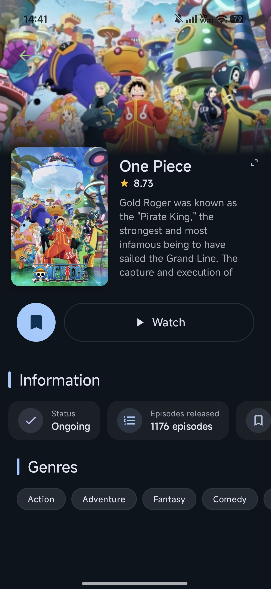

# Aura Media

<p align="center">
  
</p>

<h1 align="center">Aura Media</h1>

<p align="center">
  <b>A streaming platform for anime + movies and series with high-quality playback and automatic subtitles.</b><br/>
  <sub>پلتفرم استریم انیمه + فیلم و سریال با پخش باکیفیت و زیرنویس خودکار.</sub>
</p>

<p align="center">
  <a href="#english">English</a> · <a href="#%D9%81%D8%A7%D8%B1%D8%B3%DB%8C">فارسی</a>
</p>

<p align="center">
  
  
  
  
  
</p>

---

<a id="english"></a>

## 🇬🇧 English

### ✨ Features

- 🎬 **High-quality playback** — ExoPlayer / Media3 powered, with picture-in-picture support.
- 📺 **Movies & series** catalog browsing with search, genres, and details.
- 🔤 **Automatic subtitles** — search, download, and apply Persian/English subtitles on the fly.
- 🌐 **Multi-source extensions** — Aniyomi-compatible extension system (APK-based sources).
- 🌙 **AniList sync** — optional library sync & tracking (OAuth implicit flow).
- ⬇️ **Offline downloads** — queue, cache, and watch offline.
- 🎨 **Modern UI** — Jetpack Compose, Material 3, dark theme, RTL-ready.
- 🌍 **Bilingual** — full English & Persian (Farsi) localization.

### 📸 Screenshots

<p align="center">
  
  
  
  
</p>

### 🛠 Tech Stack

| Layer | Technology |
|---|---|
| Language | Kotlin 2.2.10 |
| UI | Jetpack Compose (BOM 2024.12.01), Material 3 |
| Player | AndroidX Media3 (ExoPlayer) |
| DI | Hilt / KSP |
| Networking | OkHttp, Retrofit |
| Serialization | kotlinx.serialization |
| DB | Room |
| Build | AGP 8.6, Gradle 8.8, compileSdk 35 |
| Min SDK | 26 (Android 8.0) |

### 🚀 Build

```bash
# Clone
git clone https://github.com/kingowow/Aura-Media.git
cd Aura-Media

# Build debug APK
./gradlew :app:assembleDebug

# Output: app/build/outputs/apk/debug/app-debug.apk
```

> Requires JDK 17. Only the **Myket** Maven mirror is reachable in Iran; the project is pre-configured with multiple mirrors (Aliyun, Myket, Iranian repos).

### 📦 Repository layout (extension index)

The `repo/` directory is an Aniyomi-style extension repository:

```
repo/
├── repo.json          # repo metadata (name, signing key fingerprint)
├── index.json         # full extension index
├── index.min.json     # minified index
├── apk/               # extension APKs
├── icon/              # extension icons
└── api/               # API definitions
```

Add this repo URL in Aniyomi / Aura Media: `https://raw.githubusercontent.com/kingowow/Aura-Media/main/repo/`

### 🤝 Contributing

1. Fork the repo
2. Create a feature branch (`git checkout -b feat/amazing`)
3. Commit (`git commit -m 'feat: add amazing feature'`)
4. Push & open a Pull Request

### 📄 License

Distributed under the MIT License. See [`LICENSE`](LICENSE) for details.

<p align="center">
  Thanks to <a href="https://github.com/akkirrai1337/hibiki">hibiki-app</a><br/>
  <sub>Kingo team telegram channel: <a href="https://t.me/kingo_team">@kingo_team</a></sub>
</p>
---

<a id="فارسی"></a>

## 🇮🇷 فارسی

### ✨ امکانات

- 🎬 **پخش کننده باکیفیت** — مبتنی بر ExoPlayer / Media3، با پشتیبانی از تصویر در تصویر (PiP).
- 📺 **کاتالوگ فیلم و سریال** با جستجو، ژانرها و جزئیات.
- 🔤 **زیرنویس خودکار** — جستجو، دانلود و اعمال زیرنویس فارسی/انگلیسی و... + ترجمه زیرنویس با هوش مصنوعی و هوشمند.
- 🌐 **افزونه‌های چندمنبعی** — سیستم افزونهٔ سازگار با Aniyomi (منابع مبتنی بر APK).
- 🌙 **کتابخانه فیلم و سریال** — ذخیره ، علامت گذاری ، دیده شده و... قسمت ها.
- ⬇️ **دانلود آفلاین** — صف، کش و تماشای آفلاین.
- 🎨 **رابط مدرن** — Jetpack Compose، Material 3، تم تاریک، پشتیبانی RTL.
- 🌍 **دو‌زبانه** — محلی‌سازی کامل فارسی و انگلیسی.

### 📸 تصاویر

<p align="center">
  
  
  
  
</p>

### 🛠 پشتهٔ فناوری

| لایه | فناوری |
|---|---|
| زبان | Kotlin 2.2.10 |
| رابط کاربری | Jetpack Compose (BOM 2024.12.01)، Material 3 |
| پخش‌کننده | AndroidX Media3 (ExoPlayer) |
| تزریق وابستگی | Hilt / KSP |
| شبکه | OkHttp، Retrofit |
| سریال‌سازی | kotlinx.serialization |
| پایگاه داده | Room |
| ساخت | AGP 8.6، Gradle 8.8، compileSdk 35 |
| حداقل SDK | 26 (Android 8.0) |

### 🚀 ساخت

```bash
# کلون
git clone https://github.com/kingowow/Aura-Media.git
cd Aura-Media

# ساخت APK دیباگ
./gradlew :app:assembleDebug

# خروجی: app/build/outputs/apk/debug/app-debug.apk
```

> نیاز به JDK 17 دارد. پروژه از پیش با چندین mirror (Aliyun، Myket، مخازن ایرانی) پیکربندی شده است.

### 📦 ساختار ریپو (ایندکس افزونه‌ها)

پوشهٔ `repo/` یک مخزن افزونهٔ سبک Aniyomi است:

```
repo/
├── repo.json          # متادیتای مخزن (نام، اثرانگشت کلید امضا)
├── index.json         # ایندکس کامل افزونه‌ها
├── index.min.json     # ایندکس فشرده
├── apk/               # APKهای افزونه
├── icon/              # آیکون‌های افزونه
└── api/               # تعریف APIها
```

آدرس این مخزن را در Aniyomi / Aura Media اضافه کنید ( به صورت پیش فرض در اپلیکیشن اضافه شده ): `https://raw.githubusercontent.com/kingowow/Aura-Media/main/repo/`

### 🤝 مشارکت

1. ریپو را Fork کنید
2. یک شاخهٔ ویژگی بسازید (`git checkout -b feat/amazing`)
3. کامیت کنید (`git commit -m 'feat: add amazing feature'`)
4. Push و باز کردن Pull Request

### 📄 مجوز

تحت مجوز MIT منتشر شده است. جزئیات در [`LICENSE`](LICENSE).

---

<p align="center">
  Made by <a href="https://github.com/kingowow">@kingowow</a><br/>
  <sub>telegram channel: <a href="https://t.me/kingo_team">@kingo_team</a></sub>
</p>
